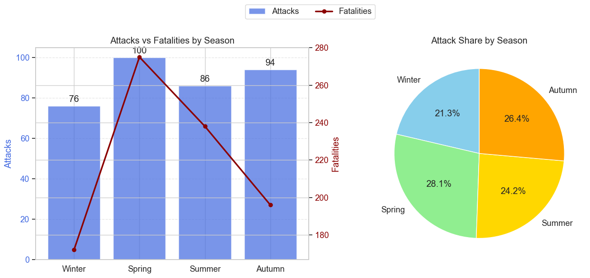
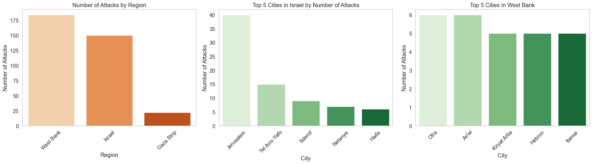

# Map of Memories: Analysis of Terror Attacks Against Israeli Civilians (2000–2023)

A team data-analysis project that explores **when, where and how** terror attacks against Israeli civilians occurred between 2000 and 2023, using victim-level data collected by B'Tselem.

**Team:** Imri Elkouby, Yuval Kirshner, Noa Manor
**Tools:** Python, Pandas, NumPy, Matplotlib, Seaborn, Jupyter Notebook

## Key findings

- **Seasonality:** Attacks are spread fairly evenly across the year (21%–28% per season), but **spring and summer attacks were the deadliest**, with about 2.75 fatalities per attack compared with about 2.1–2.3 in autumn and winter.
- **Geography:** Inside the Green Line, attacks are **concentrated in a few cities**: Jerusalem alone accounts for 40 attacks, followed by Tel Aviv-Yafo (15). In the West Bank, attacks are **spread across many locations**, and no single place has more than 6.
- **Victims by weekday:** Inside the Green Line, the average age of victims **drops towards the weekend**, while on other days it stays stable regardless of region.

## Data

- **Source:** [Kaggle:
